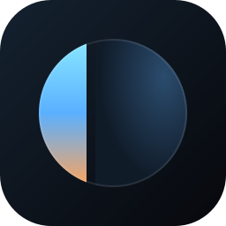

# Loka

Loka is an open-source browser in the style of Arc and Zen, built on [Helium](https://github.com/imputnet/helium)
(ungoogled-chromium). Tabs live in spaces. Each space has pinned tabs in folders that can hold more folders, and
its own list of open tabs. An Essentials grid at the top is shared by every space.

Status: early. The sidebar works as a clickable web prototype. The browser itself is still Helium with no Loka
patches yet. Windows comes first.

## Try the sidebar prototype

Needs [bun](https://bun.sh).

```
bun run setup   # install deps, pick a free port
bun run dev     # open the printed localhost URL
```

Drag tabs between Essentials, pinned folders and open tabs. Right-click for more. `Ctrl K` opens a tab and
`Ctrl 1` to `Ctrl 9` switch spaces. The prototype saves to localStorage, and the `...` menu exports or imports
spaces as JSON.

## Landing page

`site/` is Loka's landing page, with the live sidebar prototype in the hero, a waitlist and the roadmap.

```
bun run site:dev     # open the printed localhost URL
bun run site:build   # static files in site/dist
```

Set `VITE_WAITLIST_URL` when building to send waitlist signups somewhere. The form posts JSON with `email`,
`wants` (the roadmap ideas the person marked) and `source`.

## Build the browser

See [docs/browser-build.md](docs/browser-build.md). The short version: Visual Studio 2026, about 100 GB free
outside OneDrive, then `bun run browser:setup` and `bun run browser:build`. The first build takes hours.

## How this repo is laid out

This repo is a fork of [helium-windows](https://github.com/imputnet/helium-windows) and keeps its history, so
each new Helium release merges in (see [docs/upstream.md](docs/upstream.md)). Helium's files (`build.py`,
`patches/`, `helium-chromium/`) stay where Helium has them. Loka adds `patches/loka/`, `prototype/`,
`scripts/` and `docs/`.

## License

GPL-3.0, like Helium. See [LICENSE](LICENSE). Code imported unchanged from ungoogled-chromium keeps its BSD
license ([LICENSE.ungoogled_chromium](LICENSE.ungoogled_chromium)).
